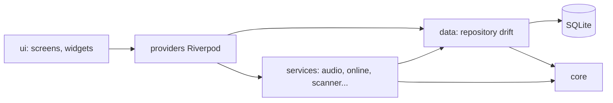

# Panoramica dell'architettura

## Scopo

FreeKmusic (ex Codecore) è un lettore musicale **standalone**: nessun backend, tutto sul dispositivo.
Una sola codebase Flutter/Dart per Android, Windows, Linux (macOS ha un job di release con zip non firmato, D-543; iOS è solo una build di prova in CI, `ci.yml`).

Questo documento dà la visione d'insieme. Le aree hanno un documento ciascuna:

| Area | Documento |
|---|---|
| Database, scansione, playlist, impostazioni, backup, cache | `libreria-e-dati.md` |
| Audio, coda, shuffle, notifica, timer, riprese | `riproduzione-e-coda.md` |
| YouTube Music, link, Shazam, arricchimento, testi, uscite, radio | `online.md` |
| Piattaforme e build | `piattaforme.md` |
| Sync, backup tra dispositivi, Jam | `sync-backup-jam.md` |
| Temi, schermate, widget, accessibilità | `ui-e-design.md` |
| Test, guardie, CI, prove su dispositivo, rilascio | `qualita-e-rilascio.md` |

Il codice vince sempre sui documenti. Le regole di lavoro sono in `../01-regole-di-lavoro.md`, le decisioni in `../decisioni.md`.

## Mappa del codice

Dipendenze ammesse: `ui` → `providers` → `services` / `data` → `core`. Mai al contrario.

| Cartella | Cosa contiene |
|---|---|
| `lib/core/` | Utilità senza stato di app: `app_log`, `clock` (`nowMs()`, `nowMsOverride`), `constants` (`kEnableYoutube`), `paths`, `platform` (`isAndroid`, `isDesktop`), `artist_key`, `text_utils`, `memory_budget`, `network_kind`, `system_volume`, `uuid`, `playlist_order` |
| `lib/data/db/` | drift: `tables.dart`, `app_database.dart` (`kSchemaVersion`, migrazioni) |
| `lib/data/repositories/` | Query e scritture sul DB (`TrackRepository`, `PlaylistRepository`, ...). Espongono `Stream` drift |
| `lib/data/settings/` | `SettingsStore` (SharedPreferences), `AppSettings`, segreti Jam |
| `lib/services/` | Logica senza UI: `audio`, `scanner`, `tags`, `import`, `backup`, `online`, `stream`, `recognition`, `shuffle_plus`, `jam`, `share`, `radio`, `podcast`, `releases`, `lyrics`, `daylist`, `memory`, `android` |
| `lib/providers/` | Riverpod: collegano servizi e repository alla UI (`player_providers`, `library_providers`, `settings_providers`, ...) |
| `lib/ui/` | `screens`, `shell`, `theme`, `widgets`. Solo presentazione |
| `lib/l10n/` | ARB in 6 lingue (it, en, de, es, fr, pt) |
| `lib/main.dart`, `lib/app.dart` | Avvio e radice dell'app (`CodecoreApp`) |
| `android/app/src/main/kotlin/com/codecore/player/` | Ponti nativi Android (widget, tile, share, volume, storage, ...) |
| `test/` | `core, data, fixtures, goldens, jam, l10n, live, providers, services, support, theme, ui` |
| `integration_test/`, `scripts/` | Test su dispositivo; script di supporto (`guardie.sh`, `arb_add.py`, `check_docs_links.py`, ...) |

La shell della UI (`lib/ui/shell/`): `app_shell`, `bottom_bar`, `desktop_player_bar`, `desktop_sidebar`, `side_panel`, `shell_nav`, `shell_keys`, `shazam_share`.

## Come funziona

### Flusso dello stato

1. Le tabelle drift sono la fonte di verità (il DB vince su tag e file, salvo la scrittura opt-in dei tag).
2. Un repository espone `Stream` drift (`watchAll`, `watchTracks`, `watchByRules`, ...).
3. Un `StreamProvider` li incapsula; la UI li osserva con `ref.watch`.
4. Le azioni passano da provider/controller (`PlayerController`, `ScanNotifier`, ...), che chiamano servizi e repository.
5. I provider sono scritti a mano (`flutter_riverpod ^3.4.3`), niente codegen.

La coda di riproduzione è separata dalla lista mostrata: la UI passa uno **snapshot** (`playFromList`), poi la coda vive da sola in `PlayQueue`.

### Impostazioni

`settingsProvider` espone `AppSettings` immutabile (`copyWith`) e scrive su `SettingsStore` con un debounce di 400 ms. Dettagli in `libreria-e-dati.md`.

### Thread

- Nessun lavoro pesante sul thread UI: I/O lungo, CPU, DB lunghi e rete vanno fuori.
- CPU e I/O pesante in `Isolate.run`: lettura tag a gruppi, zip dei backup, miniature delle copertine.
- Dopo ogni `await` in uno `State` controllare `mounted`.
- Il lavoro non essenziale aspetta `startupSettledProvider` (primo frame rasterizzato + 2 s, `providers/startup_providers.dart`).
- L'arricchimento aspetta anche l'inattività dell'utente (`providers/user_activity_provider.dart`).

### Sequenza di avvio (`lib/main.dart`)

1. `WidgetsFlutterBinding.ensureInitialized()`, `AppLog.i('avvio')`, blocco verticale su Android, licenze dei font.
2. Linux/Windows: `JustAudioMediaKit.ensureInitialized()`.
3. `applyPendingRestore(...)`: un ripristino in attesa si applica **prima** di aprire il DB.
4. `AppDatabase.production()`, `TrackRepository`, `CoverStore`, budget della image cache su Android.
5. Un solo `createYtDlpService()`, `OnlineEntries`, `RadioBrowserClient`, `RadioRepository`.
6. `CodecoreAudioHandler(CrossfadeEngine(...), PlayQueue(), ...)`. Su Android passa da `AudioService.init` (canale `com.freekmusic.player.audio`).
7. Controlli di sistema: `MprisControls` (Linux), `SmtcControls` (Windows).
8. `SettingsStore.open()`, `PlaybackPersistence`, `MediaBrowseTree` (Android Auto), `WidgetSync` (Android).
9. `StreamCache.inAppSupport()`, `ProviderContainer` con gli override, `runApp(UncontrolledProviderScope(child: CodecoreApp()))`.
10. Dopo `runApp`: `streamCache.open()`, collegamento di `handler.preparer`, `persistence.restore(...)` poi `persistence.start()`, miniature mancanti (`covers.fillMissingThumbnails()`, +5 s dal primo raster).

Override del container: `databaseProvider`, `settingsStoreProvider`, `audioHandlerProvider`, `radioClientProvider`, `ytDlpServiceProvider`, `playbackPersistenceProvider`, `playerErrorsProvider`, `coversDirProvider`, `streamCacheProvider`, `systemDeviceNameProvider`, `systemDeviceModelProvider`.

`CodecoreApp` (`lib/app.dart`) tiene vivi dalla radice i provider di servizio: `shareAutoStartProvider`, `activityLogProvider`, `equalizerApplierProvider`, `streamEnrichTriggerProvider`, `outputRouteSyncProvider`, `volumeZeroPauseProvider`, `importNotificationProvider`, `releaseCheckControllerProvider`, `dislikeStoreProvider`, `enrichCompleterStartProvider`, `mp3LengthFixStartProvider`, `podcastOrphansStartProvider`, `genreRereadStartProvider`, `artistCountryStartProvider`, `updateOnStartProvider`, `promoteErrorsProvider`, `jamOnlineFailuresProvider`. Un nuovo servizio in background si aggancia qui.

### Log

`AppLog` (`lib/core/app_log.dart`): file `codecore.log`, 2 file da 1 MB (`.1`), console in debug. Mai `catch (_) {}` muto: si logga.

## Invarianti da non rompere

- `ui` non usa `databaseProvider`, `*RepositoryProvider`, `*QueriesProvider` (D-24). Niente `PopupMenuButton` / `showMenu(`: i menu sono sheet. Lo impone `test/ui/architecture_test.dart`.
- La UI non parla né con SQLite né col pacchetto audio.
- Il DB è la fonte di verità. I tag si scrivono nei file solo con `writeTagsToFiles && tagsAlsoInFile`, via `SafeTagWriter`.
- Mai cancellare righe dell'utente in automatico: un file sparito diventa `missing = true`.
- Nessuna telemetria. Richieste web solo da azioni dell'utente o da arricchimento opt-in. Ogni richiesta ha timeout e User-Agent proprio.
- Ogni testo visibile passa da ARB.
- Commenti solo sul "perché". `dart format` file per file (larghezza 80, graffe negli `if`), mai su cartelle intere.
- Le migrazioni del DB non sono distruttive. Le chiavi salvate (`artistKey`, `PlayContextKind`) hanno un formato stabile.
- Il lavoro entra in `master` solo con PR in auto-merge (squash), check «Analyze and test».

## Come si estende

Aggiungere una funzione, dall'alto al basso:

1. **Decisione**: leggere `../decisioni.md` prima di toccare un comportamento che sembra un bug. Annotare la nuova decisione `D-xxx`.
2. **Dati**: se serve una colonna/tabella, `tables.dart` + salto di `kSchemaVersion` + passo `if (from < N)` in `onUpgrade` + `dart run build_runner build --delete-conflicting-outputs`.
3. **Repository** in `lib/data/repositories/` con metodi `Future` e `Stream`.
4. **Servizio** in `lib/services/<area>/` per la logica; niente import di `ui`.
5. **Provider** in `lib/providers/`; se è un servizio in background, avviarlo da `CodecoreApp`.
6. **UI** in `lib/ui/screens` o `widgets`, che osserva solo provider.
7. **Stringhe**: `python3 scripts/arb_add.py` (6 lingue), poi `flutter gen-l10n`. `test/l10n/arb_test.dart` esige ogni chiave in tutte le lingue; fr e pt vogliono l'apostrofo tipografico `’`; le stringhe uguali all'italiano vanno in `_sameAsItalian`.
8. **Impostazione**: campo in `AppSettings` + chiave in `SettingsStore`. Se è legata al dispositivo, aggiungerla a `kDeviceBoundKeys` del backup.
9. **Test mirati**: un test per comportamento, vicino al codice (`test/<stessa area>`). La suite completa la esegue la CI.
10. **Guardie**: `scripts/guardie.sh` (pre-push) lancia `arb_test`, `no_separator_literals_test`, `architecture_test`, `no_stray_colors_test`, lo script `check_perf_labels.py` (+ goldens se cambia `lib/ui`).
11. **Documentazione**: aggiornare il documento d'area, il file della fase in `../fasi/` e, se serve, le «Trappole» del documento.

Comandi: `flutter pub get`, `flutter analyze` (pulito), `flutter test <file>`, `flutter run -d linux`.

## Trappole

Dalle vecchie trappole (ora archiviate in `../storico/gotchas.md`):

- `flutter test -d linux` rigenera i file l10n: controllare `git status`.
- ARB in 6 lingue, fr/pt con `’`.
- `dart format` solo sui file toccati.
- Test su Windows: `deleteSync` di un file aperto fallisce.
- Goldens: cambiano con la UI, vanno rigenerati e riguardati.
- Build Linux con `HOME` finto: `rustup is not installed` (`metadata_god`).
- Gradle vuole `JAVA_HOME` su jbr-17.
- Prima di "correggere" un bug, cercarlo in `decisioni.md` (es. D-155).

## Glossario

| Termine | Significato |
|---|---|
| Blocco (blocco utente) | Brani aggiunti a mano in coda («Aggiungi in coda»): restano subito dopo il corrente, nell'ordine di aggiunta. Vedi `riproduzione-e-coda.md` |
| Riga ombra (shadow row, `kind = 2`) | Riga in `tracks` per un brano ascoltato in streaming, `path = 'stream:<key>'`. Serve a storico, statistiche, playlist |
| `kind` | 0 musica, 1 episodio podcast, 2 stream (ombra) |
| Brano online | Voce di coda con id negativo (`OnlineEntries`), non ancora in libreria |
| Jam | Ascolto condiviso tra dispositivi (LAN o MQTT a distanza). Vedi `sync-backup-jam.md` |
| Daylist | Playlist generata per fascia oraria (`services/daylist/`, file `daylist.json`) |
| Shuffle+ | Shuffle che inserisce brani simili/consigliati (`services/shuffle_plus/`) |
| Smart playlist | Playlist a regole, calcolata al volo (`watchByRules`) |
| «Da Shazam» | Playlist (`kShazamPlaylistName`) che raccoglie i brani condivisi da Shazam |
| Registro | Log delle modifiche automatiche ai brani (`activity_log`) |
| `albumKey` / `coverKey` | Identità di un album / chiave della copertina (SHA-1 di `albumKey`) |
| `artistKey` | Chiave normalizzata dell'artista, formato salvato (`lib/core/artist_key.dart`) |
| Flavor `full` / `lite` | Android con o senza yt-dlp (`CODECORE_LITE=1`, `CODECORE_YOUTUBE=false`) |

## Decisioni chiave

- D-24: la UI parla solo con i provider.
- D-539: rinomina in FreeKmusic (i nomi interni `codecore` restano: file `codecore.sqlite`, `codecore.log`, canali `codecore/*`).
- D-541: snackbar con anello di conto alla rovescia.
- D-542: questa documentazione per macroaree.
- D-543: Mac nella Release e iOS 15.5 per la prova.
